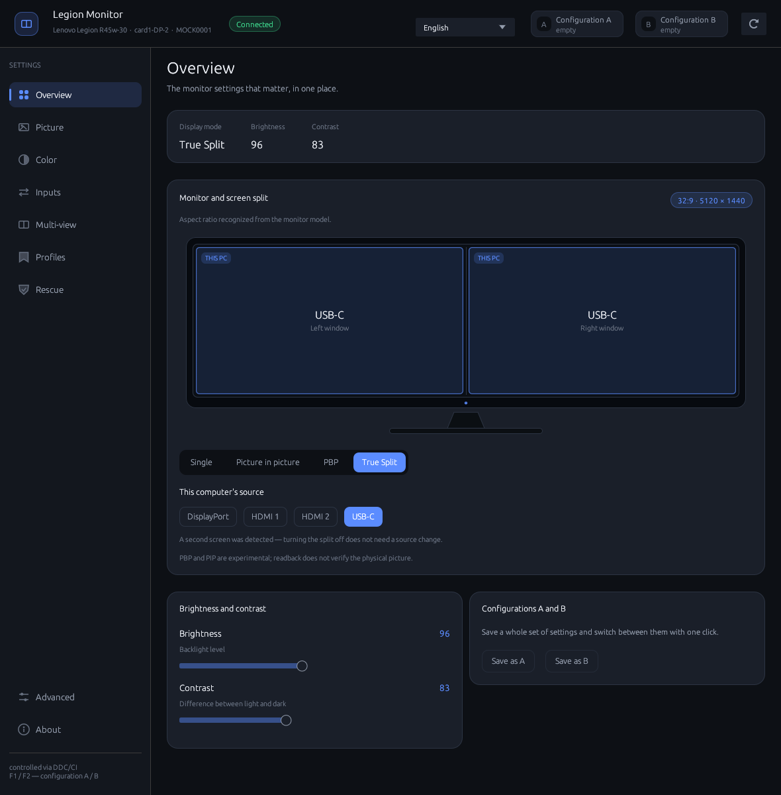
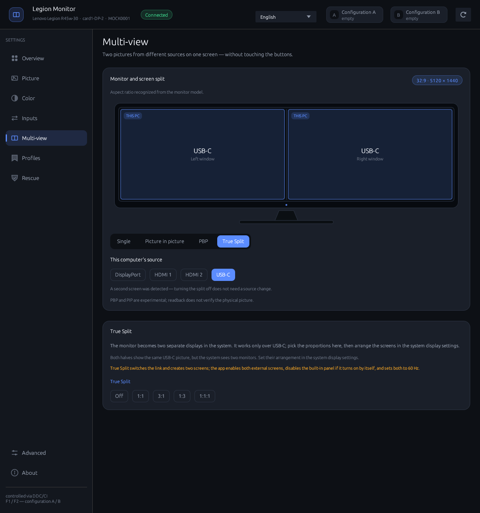

# legion-monitor

[](https://github.com/AndrewSpec/legion-monitor/actions/workflows/ci.yml)
[](https://github.com/AndrewSpec/legion-monitor/actions/workflows/release.yml)
[](LICENSE)


Control your **Lenovo Legion R45w-30** on Linux over DDC/CI without using its
physical buttons. The Rust GUI (egui/eframe) exposes brightness, contrast, color
and input controls, plus **experimental Multi-view** controls (PBP and
picture-in-picture). All monitor communication goes through `ddcutil`.

- **PBP** (picture by picture) shows two independent inputs side by side. On
  the R45w-30 it is fixed at 50/50 and is entered with `0xA5 = 0x0200`,
  `0xF5 = 0x0101` and one `0x60` write holding both source bytes
  (`right << 8 | left`). This direct two-source write and all input switches
  were confirmed on the physical monitor on 2026-11-11.
- **True Split is a first-class mode option (USB-C only).** It splits the single
  USB-C link into two 2560×1440 displays. The app writes `0xF8 = 0x15` and
  `0xF7 = mode` **first**, waits for the monitor to re-enumerate into the two
  screens (about 6 s), enables both external outputs, turns the built-in `eDP`
  panel off if the desktop switched it on by itself, and only then lowers every
  active external output to the highest refresh at or below 60 Hz through KScreen
  (`kscreen-doctor`) or XRandR. Lowering before activation is wrong: the
  pre-split screen is not the screen the split creates, and on 2026-11-12 that
  order left the panel split at 120 Hz with DDC unavailable. It appears as the
  fourth option next to Single/PIP/PBP in the mode selector, accepts only the
  USB-C input, and always allows switching the feature off. The Multi-view card
  keeps the five layout modes. Rescue still turns it off as part of its cleanup.
  Treat it as experimental until a full enable/disable cycle is verified on the
  physical monitor.

The PIP rectangle uses VCP `0x95`–`0x98`, which take panel pixels
rather than percentages. The monitor's **state register is `0xF4`**, not
`0xF2`: `0x0100`/`0x0101` means PIP and `0x0200`/`0x0201` means PBP. `0xF2`
is only the swap action (`0` closes, `1` swaps, `3` leaves full-screen), so it
must never be used to detect or open a window. Opening PIP from PBP first
closes the active split through the PBP-safe single-picture sequence (both
`0x60` bytes at our source, then `0xF2 = 0`, `0xA5 = 0` and the single input),
waits for the scaler to settle, and requires `0xF4` to report a single picture.
It then writes the rectangle (`0x95`–`0x98`) while the monitor is still
single, selects the PIP window with `0xA5 = 0x0100`, and writes the source pair
(`0x60`). **That `0x60` write is what creates the window**: the monitor
re-enumerates for about five seconds and then reports `0xF4 = 0x0100`. The app
waits for DDC to return, checks `0xF4`, verifies the rectangle, and retries the
pair once if needed. `0xA5` is write-only (it always reads back zero), so the
write is not judged by its readback. The PIP source is the high byte and the
main picture the low byte; the firmware may keep the previously valid pair if
it rejects a same-source pair, so the app does not require the pair readback to
match and relies on `0xF4` instead. A Windows 11 test ran PIP correctly at
60 Hz, while a higher refresh showed a degraded, stretched image; the Linux
attempt that lost EDID/DDC was at the default high refresh. A 60 Hz link is
therefore a prerequisite for the split modes. The app reads the refresh rate of
this monitor's active mode from the desktop topology (`kscreen-doctor -j`,
`xrandr --query` on X11) and, when it is above 60 Hz, switches the desktop to
the highest mode at or below 60 Hz at the same resolution before touching the
monitor. True Split is the exception: it is activated first, and the refresh is
lowered afterwards on each external screen the split creates. The PIP corner
tiles stay enabled and the card explains that the refresh will change. The switch was verified on 2026-11-12: the live PIP test
started at 120 Hz, the app ran `kscreen-doctor output.DP-2.mode.2`, and PIP
then opened with `0xF4 = 0x0100`. An unreadable topology is not treated as a
reason to block; the worker then proceeds without changing the rate. The rectangle is written with the
hide → move → show order: the app first writes the show value
(`0xA4 = 0xFFFF`) as a preflight, and only if that is accepted does it hide
the window (`0xA4 = 0`), move it, and show it again with retries. Firmware that
rejects the show value therefore never gets a closed mask, which is what
previously blanked the picture. On the R45w-30 the raw writes, including the
hide/show mask, were accepted and PIP reached `0xF4 = 0x0100` with the
rectangle reading back exactly; whether the inset has visible content still
depends on the second input carrying a signal. See
[Protocol findings](#protocol-findings).
Recent hardware tests also found ignored brightness writes; see
[Local hardware test results](#local-hardware-test-results-2026-11-10).

The Picture and Inputs pages also expose the vendor features available on
this monitor: HDR, Dynamic Contrast Ratio, Over Drive, Display
Scaling and Game Mode (`0xEF`, `0xEA`, `0xE0`, `0x86`, `0xF9`), plus the
`0xF8`/`0xF7` pair for DP Select, USB speed, KVM binding, Overclock and True
Split. Before a feature write the app probes the `0xFA` mutex register
(`feature << 8`) and refuses the change when another setting owns it. These
sequences are untested on the physical
monitor.


<sub>Screenshot taken without a connected monitor: the interface remains available in offline mode.</sub>

## Overview monitor graphic

The Overview page draws the panel in its actual shape instead of a generic
rectangle. The aspect ratio comes from, in order: a known Legion model
(`R45w-30` 32:9, `R34w-30` 21:9), the monitor's EDID physical image size, the
active desktop mode while no split is active, and finally a labelled 16:9
fallback. The screen shows the single input, the PBP halves with their two
sources, or the PIP window in the chosen corner, and marks the input used by
this computer. A PBP split is marked approximate unless the monitor confirmed
its layout.

The Multi-view page reuses this drawing. True Split is the fourth option in the
mode selector; its card on the Multi-view page offers the five hardware modes
(`0xF8 = 0x15`, `0xF7` = off / 1:1 / 3:1 / 1:3 / 1:1:1) only while USB-C is the
active input, and switching it off is always allowed. The PBP card offers the single 50/50 layout and, once
PBP is active, a source picker for each half. The picture-in-picture card
offers the four corners of the floating window, which occupies a quarter of the
screen. The drawing and all cards use the same bezel and panes as the Overview.

## Screenshots

Rendered in English against the offline mock monitor (`tools/mock/`), so they
show split and wide-panel states that the disconnected test monitor cannot
provide. Mock values are illustrative, not measurements.

<p>
  
  
</p>
<p align="center"><sub>Overview: PBP 50/50 on a 32:9 panel · Multi-view: PBP source pickers</sub></p>

<p>
  
  
</p>
<p align="center"><sub>Picture parameters and Lenovo F8/F7 features · Color temperature, preset and RGB channels</sub></p>

<p>
  
  
</p>
<p align="center"><sub>Input selection with Lenovo features · Overview in single mode</sub></p>

<p>
  
  
</p>
<p align="center"><sub>True Split: two external screens over USB-C · Multi-view: True Split mode card</sub></p>

<p>
  
</p>
<p align="center"><sub>Rescue: saved single picture while disconnected, ready for reconnect restore</sub></p>

## Requirements

- Linux with `ddcutil` (openSUSE: `sudo zypper install ddcutil`;
  Debian/Ubuntu: `sudo apt install ddcutil`).
- Access to `/dev/i2c-*` as a regular user. If your distribution uses the `i2c`
  group to grant device access, add your user and log out and back in:

```bash
sudo usermod -aG i2c "$USER"
```

Check access and monitor detection with `ddcutil detect`. Group membership alone
will not help if the device nodes or the required kernel module are missing.

- To build: Rust with Cargo and Wayland/X11/OpenGL development libraries.
  On openSUSE:
  `sudo zypper install rust cargo libxkbcommon-devel wayland-devel Mesa-libGL-devel`.
  On Debian/Ubuntu:
  `sudo apt install build-essential pkg-config libxkbcommon-dev libwayland-dev libx11-dev libgl1-mesa-dev`.

## Build and install

```bash
cargo build --release

./target/release/legion-monitor              # GUI
./target/release/legion-monitor --dump       # register state without the GUI
./target/release/legion-monitor --page pip    # open a specific page
```

`packaging/install.sh` installs the binary, icons and desktop entry under
`~/.local` (override this with `PREFIX`), then refreshes the icon cache and
KSycoca. Icons use hicolor sizes from 16 to 512 px when `rsvg-convert` is
available, or 256 px otherwise.

```bash
./packaging/install.sh
```

Make sure `~/.local/bin` is in `PATH`: the desktop entry launches
`legion-monitor` by name. Restart the application after installation so that the
taskbar picks up its icon.

Accepted `--page` values include `przeglad`, `obraz`, `kolor`, `zrodla`,
`multiview` (`pip`, `pbp`), `profile`, `zaawansowane` and `about`
(`o-aplikacji`).

## Prebuilt packages

There is no need to compile anything: the Release workflow
(`.github/workflows/release.yml`) builds every `v*` tag on Ubuntu 22.04 and
attaches the packages to the matching GitHub release
(<https://github.com/AndrewSpec/legion-monitor/releases>).

| Artifact | Install |
|---|---|
| `legion-monitor_<version>_amd64.deb` | `sudo apt install ./legion-monitor_<version>_amd64.deb` |
| `legion-monitor-<version>-1.x86_64.rpm` | `sudo zypper install ./legion-monitor-<version>-1.x86_64.rpm` (or `dnf`) |
| `legion-monitor-<version>-x86_64-linux-gnu.tar.gz` | unpack, then `./install.sh`, or run the binary in place |
| `SHA256SUMS` | `sha256sum -c SHA256SUMS` |

The `.deb` and `.rpm` declare `ddcutil` as a dependency; the tarball only holds
the program, so install `ddcutil` yourself and grant access to `/dev/i2c-*` as
described under [Requirements](#requirements). The packages are built against
glibc 2.35 and run on Debian 12, Ubuntu 22.04 and newer, openSUSE Leap and
Tumbleweed. The tarball unpacks to `legion-monitor-<version>/` with the binary,
icons, desktop entry, the installer, README and license.

To publish a release, bump `version` in `Cargo.toml`, commit, then push a tag:

```bash
git tag -a v0.3.0 -m "Legion Monitor 0.3.0"
git push origin v0.3.0
```

The workflow verifies that the tag matches `Cargo.toml`, builds and tests the
crate, packages it and uploads the files to the release, creating it when
needed. To rebuild a tag that predates the workflow, run *Release* from the
Actions tab and pass the tag.

`packaging/package.sh` builds the same set locally (`--formats tarball,deb,rpm`,
`--skip-build` to reuse an existing binary). `packaging/release.sh <tag>` is the
fallback when Actions is unavailable: it builds the tag in a temporary worktree
and uploads the packages with `gh` (`--dry-run` builds without uploading).
Artifacts built outside the Ubuntu 22.04 runner need the local glibc, so a
Tumbleweed build will not start on Debian 12 or Ubuntu 22.04.

## Icon

The icon depicts a monitor split into two views, using the interface colors
(`#5b8cff` on `#0d1015`). Its vector source is `assets/icon.svg`.
The application window uses `assets/icon.rgba`: headerless RGBA8 data embedded
with `include_bytes!`, avoiding a PNG decoder or additional dependencies.
After changing the artwork, regenerate the assets:

```bash
rsvg-convert -w 256 -h 256 assets/icon.svg -o assets/icon.png
tools/png_to_rgba.py assets/icon.png assets/icon.rgba
```

For desktop integration, `packaging/install.sh` installs hicolor icons at
16–512 px, and the desktop entry uses `Icon=legion-monitor`.

**Wayland:** `with_icon` only applies on X11, Windows and macOS. On Wayland, the
taskbar obtains the icon from the desktop entry matching the window's `app_id`
(`legion-monitor`). The entry must therefore be installed in the applications
directory; a shortcut on the desktop alone is not enough. The installer handles
this and refreshes KSycoca. To do it manually:

```bash
install -Dm644 packaging/legion-monitor.desktop \
  ~/.local/share/applications/legion-monitor.desktop
kbuildsycoca6 --noincremental   # KDE; restart the application afterward
```

Without this integration, KDE may show a fallback “W” icon for the Wayland window.

## Interface

Navigation is on the left, with settings grouped into cards. Normal use does not
require reading VCP codes. Feature lists come from the monitor's reported
capabilities (`ddcutil capabilities`). Enumerated features use buttons, binary
0/1 features use switches, and other adjustable values use sliders.

An advertised capability does not guarantee that writes work, especially for
unknown manufacturer-specific features. Features the monitor does not report
are not shown at all: the rows are built from the values the monitor actually
returned, so an unsupported feature leaves no trace in the interface.

| Page | Contents |
|---|---|
| Overview | Display mode, active input, brightness, contrast and A/B configuration saving |
| Picture | Brightness, contrast, sharpness, saturation, hue, gamma and black level, plus HDR, Dynamic Contrast Ratio, Over Drive, Display Scaling and Game Mode — only the features the monitor reports |
| Color | Color temperature, presets and RGB gains |
| Inputs | DisplayPort, HDMI 1, HDMI 2 and USB-C; the reported active input is highlighted. Vendor switches below the input card cover DP version, USB speed and KVM binding (`0xF8`/`0xF7`) |
| Multi-view (experimental) | The same monitor card as the Overview; **True Split** is a mode option, USB-C only, and writes `0xF8 = 0x15` + `0xF7` (off / 1:1 / 3:1 / 1:3 / 1:1:1). **PBP** is fixed at 50/50 and takes a source for each half (one `0x60` pair, no swap). The split state comes from `0xF4` (`0x0200`/`0x0201` = PBP), with an active `0xF5` layout plus the half-width desktop output as a fallback only while `0xF4` is unavailable. True Split reports the same PBP value, so the UI distinguishes it by the two external outputs it creates (DP-3 + DP-4) and a set F7 value. **PIP** offers the four corners with a quarter-size window placed with `0x95`–`0x98` in panel pixels, using the vendor hide → move → show mask order. PIP closes PBP with the PBP-safe single-picture sequence first, then writes the rectangle, `0xA5 = 0x0100`, and the `0x60` pair; that pair write opens the window, the monitor re-enumerates for a few seconds, and the app confirms PIP from `0xF4` and verifies the rectangle. PIP/PBP first lower the desktop to 60 Hz; True Split activates first, enables both external screens (and disables the built-in panel if it appeared), then lowers both to 60 Hz |
| Profiles | A/B configurations and any number of named profiles |
| Rescue | A snapshot of a working single picture, saved automatically at startup and restorable without seeing the screen; while armed, the app keeps probing for the monitor, notices a reconnect and restores the saved source, split state and picture settings |
| Advanced | Volume, mute, power mode, manufacturer-specific features and reset |
| About | Application version, author, license and links to the source repository and GitHub releases; built from Cargo metadata and available without a monitor |

Keyboard shortcuts: **F1** applies configuration A, **F2** applies configuration B,
and **F5** refreshes the state.

## Rescue mode

The Rescue page exists for the case where a split leaves the monitor without a
usable picture. It does not depend on the monitor for rendering: the page stays
available while disconnected, so it can be opened after the desktop has already
lost the display.

On the first successful read of a single picture (`0x60` is one source byte and
`0xF4` reports neither PIP nor PBP), the app stores the input, the split
registers, brightness and contrast in `settings.json`. The **Save current
state** button refreshes that snapshot while the picture is correct.

**Arm after reconnect** persists an armed flag. While armed, the app probes for
the monitor every three seconds even when the picture is already working, so it
notices both an unplug and a later replug. When the monitor answers again, it
sends the single-picture plan for the saved source plus the saved brightness and
contrast, then disarms itself if the readback confirms the source. A failed
restore keeps the flag armed and shows the error, so it can be retried manually.
The restore writes are the same ones used by the single-mode exit, including the
tolerance for the monitor's expected `EIO` during a mode change.

The snapshot is a convenience, not a firmware backup: it restores DDC settings
and the single-picture mode, not an OSD-only state such as HDR.

## Languages

The current interface supports eight languages: **Polish, English, Spanish,
French, Italian, Portuguese, Dutch and Czech**. Translation coverage does not
imply that every monitor feature has been verified on hardware.

The language picker is in the top bar. The default follows the system locale
(`LC_ALL`, `LC_MESSAGES`, `LANG`); a manual selection is saved in:

```text
~/.config/legion-monitor/settings.json     # {"language":"en"}
```

Without a saved selection, the application uses the system language.
To add a language, create a file in `src/i18n/` with an `&[(Key, &str)]` table,
then register it in `src/i18n/mod.rs`: the module, `Lang`, `LANGS`, `Lang::code`,
`strings()` and the test tables. Missing keys fall back to English, so an
incomplete translation does not break the interface.

The `every_language_has_the_same_keys` and `tables_have_no_duplicate_keys` tests
check key coverage, duplicates and `{}` placeholder counts against English.
Source comments are written in English, and interface text belongs in `i18n`.

## Development

```bash
cargo fmt --all -- --check
cargo clippy --locked --all-targets -- -D warnings
cargo test --locked
```

CI (`.github/workflows/ci.yml`) runs these checks, a release build and a
tarball/`.deb` packaging smoke test on Ubuntu 24.04. The Release workflow
(`.github/workflows/release.yml`) builds the published packages on Ubuntu 22.04
so the glibc baseline stays at 2.35. The default tests do not require a monitor.
`worker::tests::live_reversible_picture_and_profile_roundtrip` is ignored by
default and requires `LEGION_LIVE_TEST=1`, `LEGION_LIVE_SERIAL=<serial>` for
the identified test monitor and permission to access `/dev/i2c-*`.

## Profiles

Configurations A and B are two quick-access slots, available through buttons
and F1/F2. You can also save any number of named profiles. They are stored in:

```text
~/.config/legion-monitor/profiles.json
```

Example format:

```json
{
  "version": 1,
  "slots": { "a": null, "b": null },
  "profiles": [
    {
      "id": "p1",
      "name": "Example picture settings",
      "values": { "10": 80, "12": 70 }
    }
  ]
}
```

`values` maps hexadecimal VCP codes to numeric values. Saving and applying a
profile share an allowlist that excludes reset, status, power and unknown
manufacturer-specific registers. Only allowed settings present in the current
readback are saved. Values loaded from existing profile files are filtered too.

Applying a profile sends a sequence of writes with short pauses because mode
changes may interrupt the EDID/DDC connection. The color preset is restored
after temperature/RGB settings, since those writes can change the preset.
This ordering still needs a hardware roundtrip: some preset/RGB combinations
may not coexist. Multi-view settings are written in the order `0xF5`, then
`0xF2` (legacy exchange), with the input switch last. A PBP source change
writes `0xA5 = 0x0200`, an optional `0xF5` layout repair and then both sources in
one `0x60` write. Entering PBP first clears a legacy hardware True Split
(`0xF8 = 0x15`, `0xF7 = 0`), opens PBP, writes the layout and seeds both halves
with this computer’s input; this makes `0x60` readable so either half can then be
changed. Leaving PBP clears the legacy feature, writes both `0x60` bytes at our
source, writes `0xF2 = 0`, `0xA5 = 0` and finally the plain single input. It never
writes `0xA5 = 0x0100` while PBP is open. PBP is detected from `0xF4`
(`0x0200`/`0x0201`); only when `0xF4` is unavailable does the app fall back to a
valid `0xF5` layout plus a half-width desktop output. Opening PIP from a split
first runs the PBP-safe exit, waits for the scaler, probes `0xF4` up to three
times and refuses to continue while the monitor still reports a split. It then
writes the window rectangle (`0x95`–`0x98`, panel pixels) with the
hide → move → show mask sequence, selects the PIP window with `0xA5 = 0x0100`,
and writes the source pair with `0x60`. That pair write is what creates the
window: the monitor re-enumerates for a few seconds, after which PIP is
confirmed from `0xF4 = 0x0100` and the rectangle readback. The app retries the
pair once if `0xF4` does not report PIP. `0xA5` is write-only (always reads
back zero), so its return value is not used as proof. The firmware may keep the
previously valid pair when it rejects a same-source pair, so the app does not
require the pair readback to match; the source picker still shows the intended
inputs. `0xA4` is written with a show-value preflight, so a rejected `0xFFFF`
never leaves a closed mask that would blank the picture. Leaving a split uses a
different sequence, because closing PBP can leave the monitor on either half:

1. the application determines which monitor input this computer is using
   (the single-mode `0x60` value, a connector match in the active PBP pair, or
   the user’s choice);
2. if an independent second screen is connected, it only writes `0xA5 = 0` —
   the desktop can always be recovered on that screen;
3. without a second screen it first writes `0x60 = (source << 8) | source` while
   PBP is still active, so both halves show this computer, then closes the split
   with `0xA5 = 0`, writes the single input `0x60 = source`, and disables the
   PIP/PBP window with `0xF2 = 0`. The last write matters for PIP: the pair and
   selector alone left an active PIP window on the test unit.

The topology check uses `kscreen-doctor -j`, falling back to `xrandr --query`;
if neither can be read, the application treats the topology as unknown and asks
for the source instead of guessing. Success requires matching readback; a
successful command exit alone is not sufficient.

There is no guarantee of atomic rollback on failure: some settings may already
have changed. A/B highlighting reflects a match between the entire nonempty
replay plan and the latest monitor readback, not the last button clicked.
Slots are not marked as matching while an operation is running or when required
registers are missing from the readback.

## Protocol findings

These findings come from protocol observations on the physical monitor.
Accepting an `0xA5`/`0x60` write and reading back its value does not prove that
the physical picture matches a preview. The monitor's mode is reported by
**`0xF4`**, not `0xF2`: `0x0100`/`0x0101` is PIP, `0x0200`/`0x0201` is PBP.
`0xF2` is only the swap action. The PIP path was exercised several times: the
first attempt left a zero rectangle, a later one opened the window with
`F2 = 1` (wrong register), and the final raw sequence placed the rectangle with
hide → show, selected the window with `0xA5 = 0x0100`, wrote the `0x60` pair,
tolerated the scaler re-enumeration, and then read `0xF4 = 0x0100` with the
rectangle intact. The `0x60` pair write is what creates the window; `0xA5`
alone does nothing on this unit and always reads back zero. A same-source pair
(`0x3131`) is accepted by the I2C layer but the firmware keeps the previously
valid pair (`0x1131`), while still opening PIP. A visual check of the quarter's
content and a different second source are still pending.

Longer session notes, including safe write sequences and failure modes, are in
[notes/ddc-protocol.md](notes/ddc-protocol.md).

| Feature | VCP | Evidence / direction | Notes |
|---|---|---|---|
| Multi-view control | `0xF2` | Write observed | It is named *PIP/PBP Swap*: `0` disables the PIP/PBP window, `1` swaps the sources, `3` leaves full-screen mode. It is **not** a mode register: it stays `1` in single, PIP and PBP on the R45w-30. Do not use it to detect or open a window |
| Split layout | `0xF5` | Write and readback observed | It is named *PBP Control*: low byte = position (`1` right, `2` left, `3` top, `4` bottom), high byte = ratio (`1` 1:1, `2` 2:1, `3` 1:2, `4` 3:1). On the R45w-30 only `0x0101` (50/50) and `0x0401` (about 70/30) change the picture; the app uses only `0x0101` for PBP. Current `0xF5` also reports True Split layouts (`0x0402` = 1:1:1) |
| Window state | `0xF4` | Read observed; write causes re-enumeration | The authoritative mode: `0x0100`/`0x0101` PIP, `0x0200`/`0x0201` PBP, anything else single. The app derives all Multi-view state from this register and fallbacks only when it is unavailable. Writing `0xF4` triggers a scaler reset but the monitor does not stay in the requested mode, so the app never writes it |
| Monitor feature index | `0xF8` | Write and readback observed | Selects a feature before `0xF7` is read or written. `0x15` is *True Split*; the same register also selects KVM, DP Select, USB Select, eKVM and Light Control |
| True Split switch | `0xF7` | Write and readback observed | After `0xF8 = 0x15`: `0` off, `1` 1:1, `3` 3:1, `2` 1:3, `4` 1:1:1. The app writes the pair only from the True Split mode option (USB-C only) and from rescue/PBP cleanup (`0`, `0`). Writing the pair makes the link re-enumerate into two screens; the app waits, enables both external outputs, disables `eDP` if the desktop enabled it, and then lowers each external output to 60 Hz. Lowering before the pair is wrong and was the 2026-11-12 failure. |
| Feature mutex | `0xFA` | Probe on the physical monitor | Write `feature << 8` (e.g. `0xF715` True Split, `0xA500` PIP/PBP, `0xEF00` HDR), wait 50 ms, read back; `token | 1` or `1` means another setting owns the feature. The app probes it before `F8`/`F7` and before opening PIP, and treats a failed probe as unlocked |
| Window mask | `0xA4` | Write observed on the R45w-30 | `0` hides the PIP window while it is moved, `0xFFFF` shows it again. The app preflights `0xFFFF`; only when that is accepted does it write `0`, move the rectangle, and retry the show up to five times. If the preflight is rejected no mask is written, so a failed hide cannot blank the picture |
| PIP window rectangle | `0x95`–`0x98` | Write and range read observed on the R45w-30 | Left, top, right and bottom in **panel pixels**: the R45w-30 reports maxima 4960/1320/5120/1440 for a 5120×1440 panel, so the app writes a quadrant such as `(0, 0, 1280, 720)`. The rectangle must be written **before** the PIP window is created; the final sequence is hide/move/show, then `0xA5 = 0x0100`, then the `0x60` pair. Opening with `0x60` re-enumerates but does not reset the already-written rectangle. `GetPIPWndRect` reads the same four codes. Writing `0..100` here made a 100-pixel window and is the bug behind the first PIP attempt |
| Window selection | `0xA5` | Write observed | It is named *Window Select*: `0x0000` closes PIP/PBP, `0x0100` selects the PIP window, `0x0200` the PBP window. The monitor accepts every write but never reads the selection back and never changes `0xF4` on its own; the `0x60` pair write is what opens the window |
| Window inputs | `0xF0` | Read observed | It is named *Audio Source*; on the R45w-30 it reports the two window sources (low byte = left window, high byte = right) but is unreadable most of the time (`0xFFFF`) |
| Input source | `0x60` | Read/write control | `0x0f` DP, `0x11` HDMI 1, `0x12` HDMI 2, `0x31` USB-C. Outside a split it takes one source byte. In PBP the pair is written as `(right << 8) | left`; that is the direct way to set the right half, with no `0xA5` selector and no `0xF2` exchange. For PIP the high byte is the PIP source and the low byte the main picture; the write that creates the window also re-enumerates the display for a few seconds. `0xA5 = 0x0200` was verified on the R45w-30; `0xA5 = 0x0100` in PBP froze the monitor's OSD |
| Brightness / contrast | `0x10` / `0x12` | Standard DDC controls | Reads work in local tests; the recent brightness-change test failed, as described below |

PBP opens with `0xA5 = 0x0200`; the `F5` layout selects the split and `0x60`
carries the two-source pair. PIP uses the same `0xA5` selector, but on this
unit `0xA5 = 0x0100` alone does nothing; the subsequent `0x60` pair write
creates the window, triggers a short re-enumeration, and only then does `0xF4`
report `0x0100`. The hide/move/show sequence places the rectangle with
`0xA4 = 0`, `0x95`–`0x98`, then `0xA4 = 0xFFFF`, and the app reproduces that
order. The application writes that mask sequence and does not write `0xF4`
directly. `0xA5`/`0x60` writes can make
the monitor disappear for several seconds (`EDID has changed`), so reads are
retried, writes use `--noverify`, and the PIP path waits for DDC to return before
checking `0xF4`.

## Local hardware test results (2026-11-10/12)

The tested R45w-30 reported brightness `100`, contrast `87` and USB-C input
(`0x31`); these values also appeared in the GUI. The read-path repair includes
`--terse` output, short batches of VCP codes and removal of the worker's
48-feature limit.

The 2026-11-12 raw-VCP session established the real Multi-view contract:

- **`0xF4` is the state register.** Single reads `0x0000`; PIP reads `0x0100`
  (or `0x0101` after a swap); PBP reads `0x0200` (or `0x0201`). The app now
  derives every mode from it and only falls back to `0xF5` plus a half-width
  output while `0xF4` is unavailable.
- **`0xF2` is not the state.** It stayed `1` (maximum `1`) in single, PIP and
  PBP. It is the swap action: `0` closes, `1` swaps, `3` leaves full-screen.
  Writing `F2 = 1` after `A5` opened nothing; the earlier claim that it did was
  a misread of the mode.
- **`0xA5` is write-only and inert on its own.** Raw two-byte writes of
  `0x0000`, `0x0001`, `0x0002`, `0x0100`, `0x0200`, `0x0300` all returned
  `rc=0`, always read back `0`, and left `F4`/`F5`/`0x60` unchanged.
- **The PIP sequence that worked** was: write the rectangle with
  `0xA4 = 0xFFFF` preflight, `0xA4 = 0`, `0x95..0x98`, `0xA4 = 0xFFFF`;
  then `0xA5 = 0x0100`; then `0x60 = 0x3131`. The `0x60` write made the monitor
  re-enumerate for about 5–7 s; afterwards `F4` read `0x0100` and the rectangle
  read back exactly. `0x60` is the write that creates the window, not `A5`.
- The firmware ignored the same-source pair `0x3131` and kept the previously
  valid `0x1131` pair, yet still opened PIP. The app therefore does not require
  the `0x60` pair readback to match; it requires `F4 = 0x0100` and the rectangle
  readback. A same-source pair is not a reliable way to duplicate this
  computer’s input.
- Writing `F4` itself (`0x0100` or `0x0200`) also triggered a scaler
  re-enumeration, but the monitor did not stay in the requested mode. F4 is
  read-only in practice and the app never writes it.
- Only USB-C was active during these tests. The PIP window opened with
  `F4 = 0x0100`, but whether its content is visible still depends on a second
  input carrying a signal; the inset was not visually confirmed because the
  hardware overlay is not part of the compositor framebuffer.

Other confirmed findings:

- Sharpness (`0x87`) is shown in the raw DDC scale while the OSD shows 0-100 in
  steps of 20 (`4 → 80`, `5 → 100`). The monitor reports a maximum of `4` but
  uses `5` for OSD 100, and writing `5` always fails — that value can only be
  restored from the OSD.
- Gamma (`0x72`) is displayed as a raw number (`35840` for `+0.2`) and its
  slider (`0..40960`) cannot reliably hit the monitor's discrete presets: a
  one-pixel error produced `35500`, which the monitor rejected.
- The color temperature row offers four fixed values while the monitor uses a
  `0..63` scale, so the current value is never highlighted and a click writes an
  unrelated value.
- In the tested `1f7936b` build, the inputs page repeated entries and labelled
  USB-C as "Unrecognized value", because the capability string lists
  `0F 11 12 31 FF 0F 11 12 31`. The current working-tree parser deduplicates
  inputs and uses known connector names; this is a software fix, not a new
  hardware verification.
- Switching the input from USB-C to HDMI 1 and back worked; the monitor kept
  answering over DDC while the picture was gone.
- Split modes need a 60 Hz link. In a Windows 11 test PIP worked at 60 Hz; at a
  higher refresh the image was rendered at a lower resolution and stretched.
  The Linux attempt that produced a 0-byte EDID and only 640x480 was running the
  high-refresh mode. For PIP/PBP the app reads the active mode from KScreen (or
  `xrandr --query` on X11) and lowers it before the split write. For True Split
  it activates first, waits for both new screens, and lowers each external
  output afterwards.
- Multi-view: the monitor accepts only two PBP ratios. `0x0101` splits the
  picture 50/50 (confirmed on screen) and `0x0401` about 70/30 (75/25 in the
  register). The app uses only `0x0101` for PBP. Other `F5` values are rejected
  or ignored, so the UI no longer offers them.
- On 2026-11-11 the direct PBP pair write was exercised through the GUI on the
  R45w-30: PBP was enabled, the left and right sources were selected, and all
  inputs switched correctly. In PBP both window sources are written at once:
  `0x60 = (right << 8) | left`; the low byte is the left/primary window and the
  high byte the right/secondary one. No `0xA5` selector and no `0xF2` exchange
  are needed.
- `0xA5 = 0x0200` opens the PBP window and `0x0100` selects the PIP window;
  mixing them up is what froze the OSD on the R45w-30. Outside a split `0x60`
  still takes a single source byte.
- `0xF0` reports the sources of both windows (low byte = left, high byte = right)
  but is unreadable most of the time (`0xFFFF`). The application falls back to the
  pair read from `0x60`.
- Rescue commands sent while the monitor was gone used to leave the app busy
  forever: the worker now releases the busy state on the no-monitor path.
  Arming only schedules a probe: it never closes a working split by itself.
  Auto-restore fires on a disconnected → connected transition, and a failed
  attempt is not retried in a tight loop; "Restore now" is the explicit path.
- The main source is the low byte of a `0x60` pair when a split is active, or the
  single byte otherwise — not the saved "this computer" setting. PIP defaults to
  that source until a second input is picked, instead of trusting a stale
  unconnected source from `0xF0`.
- True Split is the fourth option in the mode selector, with USB-C as the active
  input; switching it off is always allowed.
  On 2026-11-12 enabling it over USB-C switched the link to 2560×1440@120, the
  panel went black and DDC disappeared; the compositor owns the refresh rate.
  The app now waits for the two split screens, enables both external outputs,
  disables the built-in panel if it appeared, and lowers both to 60 Hz afterwards. A full enable/disable cycle has not been verified through the new
  mode option, so it is marked experimental. Rescue still clears the feature (`0xF8 = 0x15`, `0xF7 = 0`) in
  case the OSD or an older build left it on.

The full field-by-field matrix and the remaining gaps are kept as local
hardware notes outside the repository. A successful build and passing tests
without a monitor do not establish hardware support. The PBP two-source path
has been exercised on the monitor. PIP reached `F4 = 0x0100` with the correct
rectangle readback in the 2026-11-12 raw session; the
`live_pip_corner_roundtrip` test then passed the same day through the real
worker (corner `2560,0,5120,1440`, `F4 = 0x0100`, exact rectangle readback).
All four corners were then verified individually through the same live test
(TR, TL, BL, BR); each returned `F4 = 0x0100`/`0x0101` and its exact quadrant
readback. The inset content and a second-source picture have not been visually
confirmed.

## Offline behavior

When no monitor is connected, the application shows “Offline” and keeps all
sections visible with empty values as an interface preview, not a claim of
monitor support. Profiles, Rescue and About remain accessible; applying settings
requires a connection and readback, while the Rescue snapshot can be armed and
saved offline. About only reads build metadata and project links, so it needs no
monitor at all. “Search again” reruns monitor detection.

## Code structure

| File | Responsibility |
|---|---|
| `src/main.rs` | Entry point, `--dump`, `--page` |
| `src/about.rs` | Version, author, license and repository metadata from Cargo, plus the GitHub releases URL |
| `src/ddc.rs` | `ddcutil` calls and `detect`/`capabilities`/`getvcp` parsing |
| `src/catalog.rs` | Feature catalog (VCP codes → `Key`), sections, split-layout/PIP geometry and modes |
| `src/i18n/mod.rs` | `Lang`, `Key`, `Strings` and locale-based language selection |
| `src/i18n/<lang>.rs` | Translation tables (`ENTRIES`) |
| `src/settings.rs` | Language, Rescue baseline and armed flag in `settings.json` |
| `src/topology.rs` | Desktop display scan (KScreen/XRandR) and monitor-link inference |
| `src/panel.rs` | Panel aspect detection from model, EDID, desktop mode or fallback |
| `src/worker.rs` | Worker thread, commands, events and read retries |
| `src/profiles.rs` | Profile JSON persistence and configuration directory |
| `src/ui/mod.rs` | Application state (`App`), update loop, shortcuts and worker communication |
| `src/ui/theme.rs` | Palette, styling and navigation icons |
| `src/ui/widgets.rs` | Cards, chips, segmented controls, split and PIP tiles |
| `src/ui/rows.rs` | Feature rows: sliders, switches, choices and placeholders |
| `src/ui/chrome.rs` | Top bar, sidebar, offline banner and language picker |
| `src/ui/pages/*.rs` | One module per page |
| `src/ui/screen.rs` | Overview monitor drawing (bezel, stand, single/PBP/PIP panes) |
| `assets/icon.svg` | Vector source for the application icon |
| `assets/icon.png` | 256×256 desktop icon |
| `assets/icon.rgba` | Raw RGBA data embedded in the window (`include_bytes!`) |
| `packaging/legion-monitor.desktop` | Desktop entry, icon, `StartupWMClass` and `app_id` |
| `packaging/install.sh` | Binary, icon and desktop entry installation under `~/.local` |
| `packaging/package.sh` | Tarball, `.deb`, `.rpm` and `SHA256SUMS` in `dist/` |
| `packaging/release.sh` | Local fallback: builds a tag in a worktree and uploads the packages |
| `tools/png_to_rgba.py` | PNG → RGBA conversion after icon changes |
| `tools/mock/` | Offline `ddcutil`/`kscreen-doctor` mocks and deterministic screenshots |
| `tools/render-live.sh` | Renders the real monitor state on a private Xvfb server |
| `docs/screenshot.png` | Interface screenshot used in this README |
| `.github/workflows/ci.yml` | Formatting, Clippy, tests, build and packaging smoke test |
| `.github/workflows/release.yml` | Tag builds: tarball, `.deb` and `.rpm` attached to the release |
| `LICENSE` | GPL-3.0-only license |

## License

This project is licensed under **GPL-3.0-only**. See [LICENSE](LICENSE) for the
full license text.
