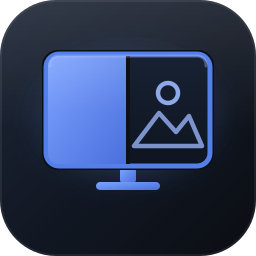
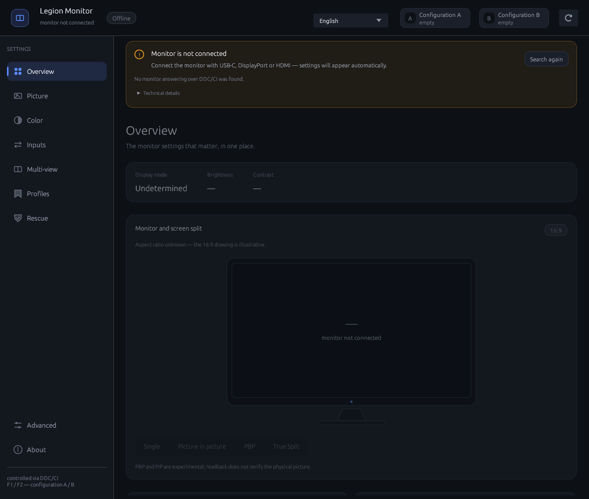
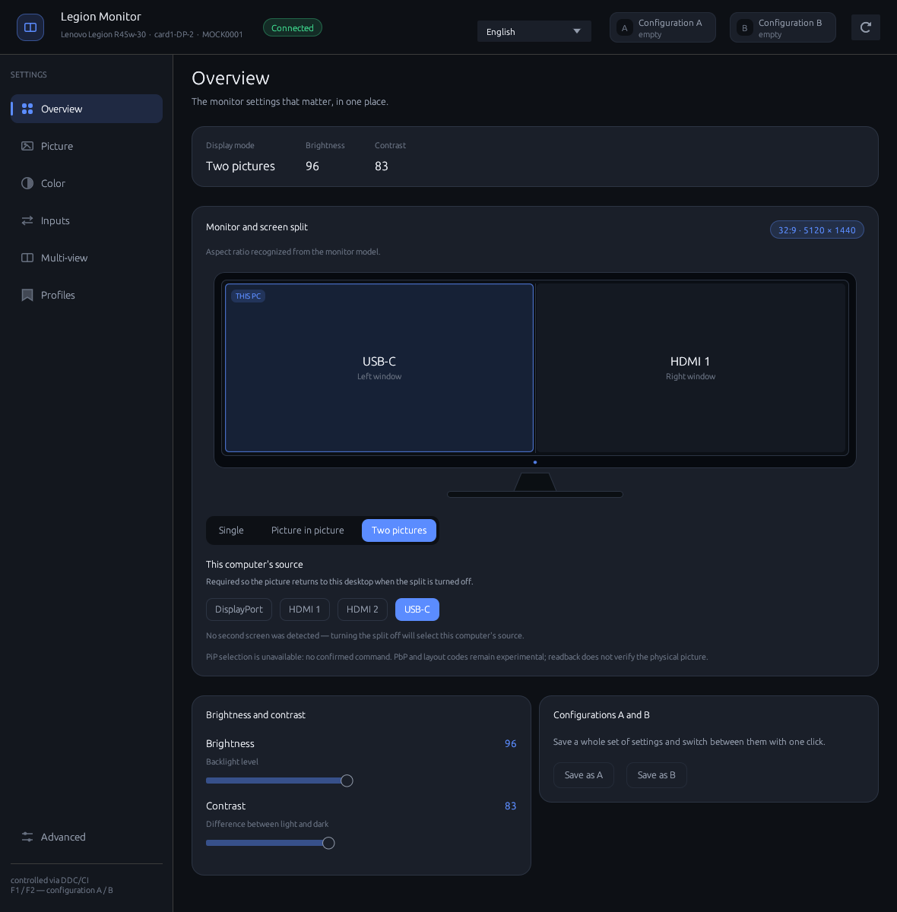
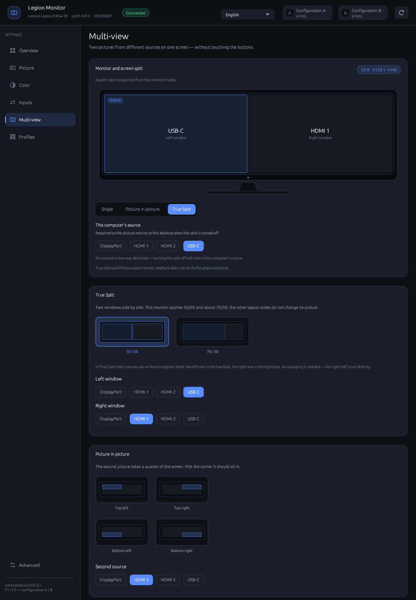
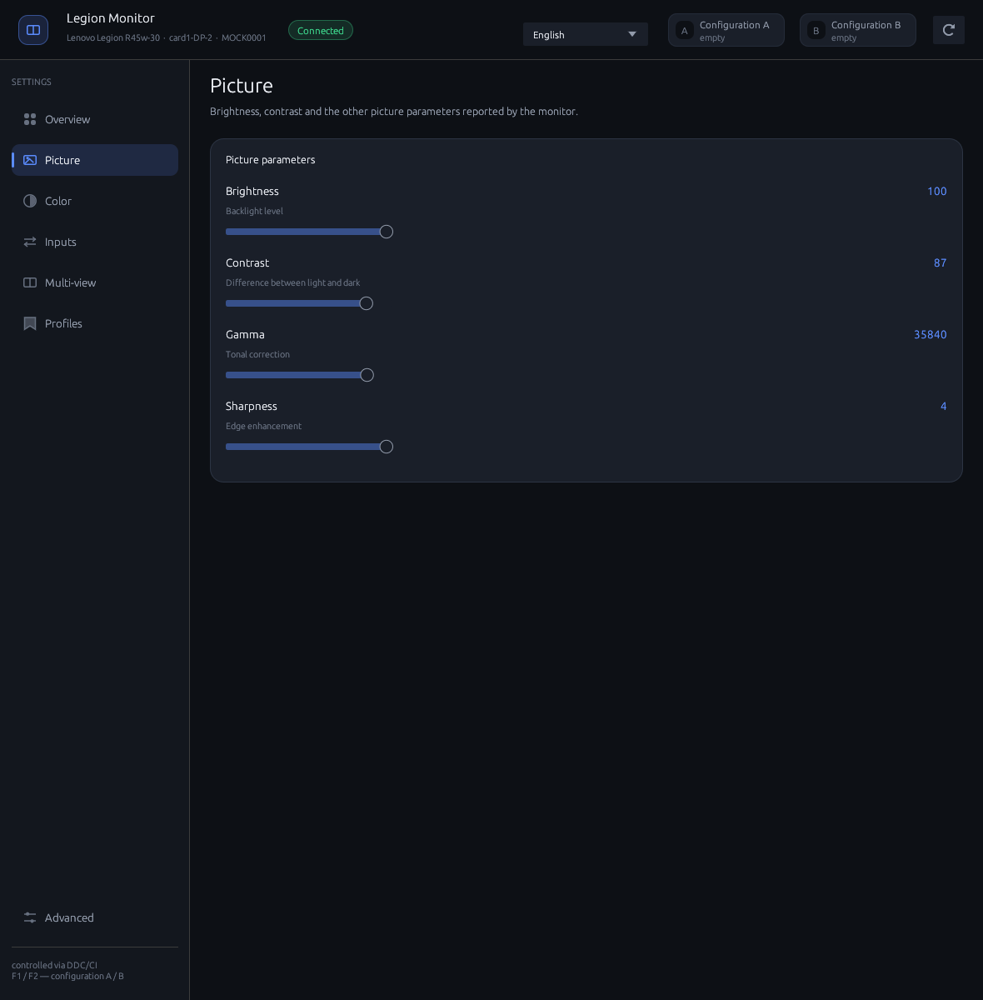
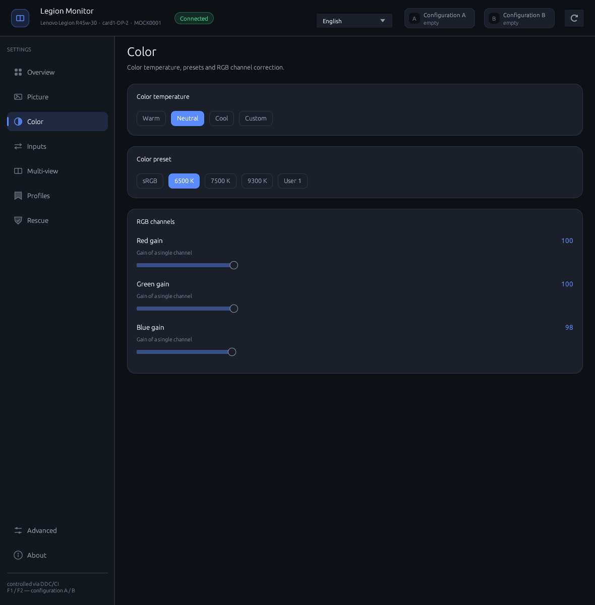
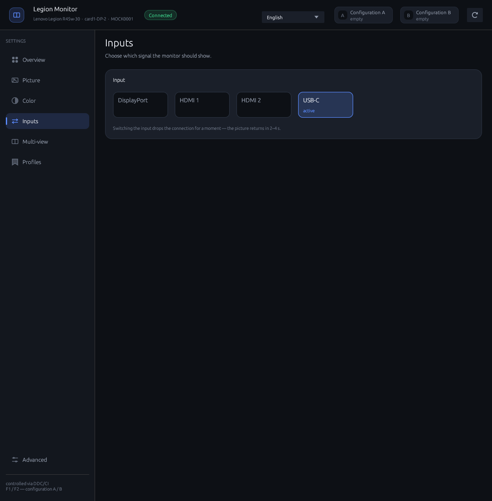
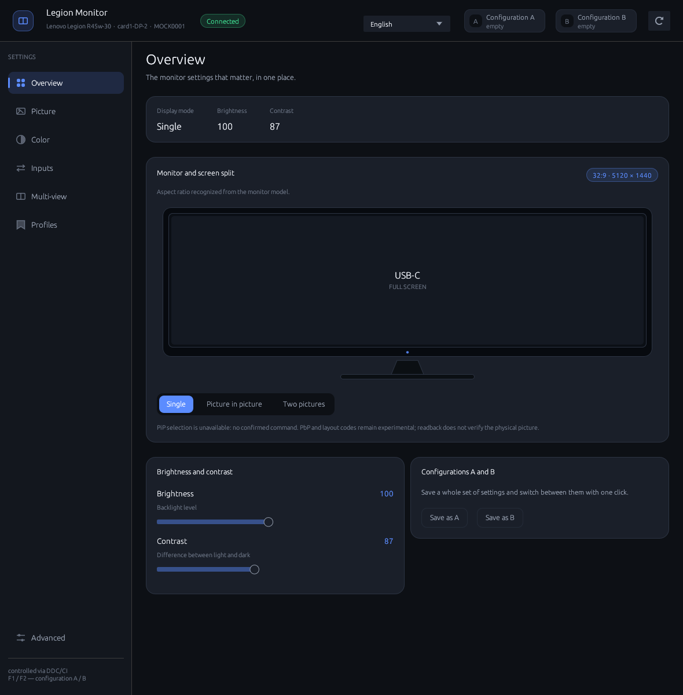
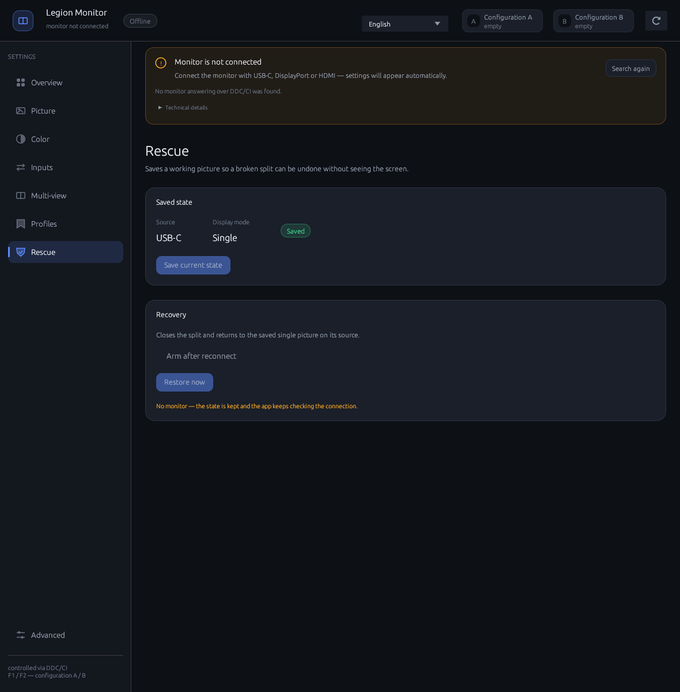

# legion-monitor

[](https://github.com/AndrewSpec/legion-monitor/actions/workflows/ci.yml)
[](LICENSE)



Control your **Lenovo Legion R45w-30** on Linux over DDC/CI without using its
physical buttons. The Rust GUI (egui/eframe) exposes brightness, contrast, color
and input controls, plus **experimental Multi-view** controls (True Split and
picture-in-picture). All monitor communication goes through `ddcutil`.

**Hardware support is partly verified.** The direct two-source True Split write
and all input switches were confirmed on the physical R45w-30 on 2026-11-11.
True Split is limited to the two ratios the monitor accepts (50/50 and about
70/30). The PIP rectangle uses Lenovo's VCP `0x95`–`0x98`, which take panel
pixels rather than percentages. Opening PIP from True Split exposed a firmware
hazard: the PBP window must be closed with the full single-picture sequence
first, because `0xA5 = 0x0100` while PBP is active freezes the OSD, and a
following `0x60` write can point the main picture at an inactive source (black
screen). The application now closes PBP, verifies through `0xF4` that the
monitor reports a single picture, writes the rectangle (`0x95`–`0x98`) while
the monitor is still single, checks that it reads back, selects the PIP window,
confirms through `0xF4` that it opened, and only then writes the PIP source. It does
not write `0xA4`: the monitor rejected the show value in testing and a mask left
at zero blanks the whole picture. The monitor often answers `EIO` to `0xA5`
while still applying it, so that write is verified by state instead of its
return code. See [Protocol findings](#protocol-findings). PIP placement itself
is not confirmed on the monitor yet.
Recent hardware tests also found ignored brightness writes; see
[Local hardware test results](#local-hardware-test-results-2026-11-10).



<sub>Screenshot taken without a connected monitor: the interface remains available in offline mode.</sub>

## Overview monitor graphic

The Overview page draws the panel in its actual shape instead of a generic
rectangle. The aspect ratio comes from, in order: a known Legion model
(`R45w-30` 32:9, `R34w-30` 21:9), the monitor's EDID physical image size, the
active desktop mode while no split is active, and finally a labelled 16:9
fallback. The screen shows the single input or the PBP/PiP panes, both window
sources, the share of the two True Split layouts the R45w-30 accepts (50/50 and
about 70/30), or the PIP window in the chosen corner, and marks the input used
by this computer. A True Split is marked approximate unless the monitor
confirmed its layout.

The Multi-view page reuses this drawing. Its True Split card offers the two
layouts the monitor accepts; the picture-in-picture card offers the four corners
of the floating window, which occupies a quarter of the screen. The drawing and
both cards use the same bezel and panes as the Overview.

## Screenshots

Rendered in English against the offline mock monitor (`tools/mock/`), so they
show split and wide-panel states that the disconnected test monitor cannot
provide. Mock values are illustrative, not measurements.

<p>
  
  
</p>
<p align="center"><sub>Overview: True Split 50/50 on a 32:9 panel · Multi-view: True Split and PIP previews</sub></p>

<p>
  
  
</p>
<p align="center"><sub>Picture parameters · Color temperature, preset and RGB channels</sub></p>

<p>
  
  
</p>
<p align="center"><sub>Input selection · Overview in single mode</sub></p>

<p>
  
</p>
<p align="center"><sub>Rescue: saved single picture while disconnected, ready for reconnect restore</sub></p>

## Requirements

- Linux with `ddcutil` (openSUSE: `sudo zypper install ddcutil`;
  Debian/Ubuntu: `sudo apt install ddcutil`).
- Access to `/dev/i2c-*` as a regular user. If your distribution uses the `i2c`
  group to grant device access, add your user and log out and back in:

```bash
sudo usermod -aG i2c "$USER"
```

Check access and monitor detection with `ddcutil detect`. Group membership alone
will not help if the device nodes or the required kernel module are missing.

- To build: Rust with Cargo and Wayland/X11/OpenGL development libraries.
  On openSUSE:
  `sudo zypper install rust cargo libxkbcommon-devel wayland-devel Mesa-libGL-devel`.
  On Debian/Ubuntu:
  `sudo apt install build-essential pkg-config libxkbcommon-dev libwayland-dev libx11-dev libgl1-mesa-dev`.

## Build and install

```bash
cargo build --release

./target/release/legion-monitor              # GUI
./target/release/legion-monitor --dump       # register state without the GUI
./target/release/legion-monitor --page pip    # open a specific page
```

`packaging/install.sh` installs the binary, icons and desktop entry under
`~/.local` (override this with `PREFIX`), then refreshes the icon cache and
KSycoca. Icons use hicolor sizes from 16 to 512 px when `rsvg-convert` is
available, or 256 px otherwise.

```bash
./packaging/install.sh
```

Make sure `~/.local/bin` is in `PATH`: the desktop entry launches
`legion-monitor` by name. Restart the application after installation so that the
taskbar picks up its icon.

Accepted `--page` values include `przeglad`, `obraz`, `kolor`, `zrodla`,
`multiview` (`pip`, `pbp`), `profile` and `zaawansowane`.

## Icon

The icon depicts a monitor split into two views, using the interface colors
(`#5b8cff` on `#0d1015`). Its vector source is `assets/icon.svg`.
The application window uses `assets/icon.rgba`: headerless RGBA8 data embedded
with `include_bytes!`, avoiding a PNG decoder or additional dependencies.
After changing the artwork, regenerate the assets:

```bash
rsvg-convert -w 256 -h 256 assets/icon.svg -o assets/icon.png
tools/png_to_rgba.py assets/icon.png assets/icon.rgba
```

For desktop integration, `packaging/install.sh` installs hicolor icons at
16–512 px, and the desktop entry uses `Icon=legion-monitor`.

**Wayland:** `with_icon` only applies on X11, Windows and macOS. On Wayland, the
taskbar obtains the icon from the desktop entry matching the window's `app_id`
(`legion-monitor`). The entry must therefore be installed in the applications
directory; a shortcut on the desktop alone is not enough. The installer handles
this and refreshes KSycoca. To do it manually:

```bash
install -Dm644 packaging/legion-monitor.desktop \
  ~/.local/share/applications/legion-monitor.desktop
kbuildsycoca6 --noincremental   # KDE; restart the application afterward
```

Without this integration, KDE may show a fallback “W” icon for the Wayland window.

## Interface

Navigation is on the left, with settings grouped into cards. Normal use does not
require reading VCP codes. Feature lists come from the monitor's reported
capabilities (`ddcutil capabilities`). Enumerated features use buttons, binary
0/1 features use switches, and other adjustable values use sliders.

An advertised capability does not guarantee that writes work, especially for
unknown manufacturer-specific features. Features the monitor does not report
are not shown at all: the rows are built from the values the monitor actually
returned, so an unsupported feature leaves no trace in the interface.

| Page | Contents |
|---|---|
| Overview | Display mode, active input, brightness, contrast and A/B configuration saving |
| Picture | Brightness, contrast, sharpness, saturation, hue, gamma and black level — only the features the monitor reports |
| Color | Color temperature, presets and RGB gains |
| Inputs | DisplayPort, HDMI 1, HDMI 2 and USB-C; the reported active input is highlighted |
| Multi-view (experimental) | The same monitor card as the Overview, the two supported True Split ratios (50/50 and about 70/30) and the four PIP corners with a quarter-size window; True Split writes both sources in one `0x60` pair, without a swap, and PIP is placed with `0x95`–`0x98` in panel pixels, after PBP is closed and `0xF4` confirms a single picture; the PIP source is written only after the rectangle reads back and `0xF4` reports the window. Leaving a split checks for a second screen and, when there is none, keeps this computer’s source visible; PIP placement still needs a clean hardware run |
| Profiles | A/B configurations and any number of named profiles |
| Rescue | A snapshot of a working single picture, saved automatically at startup and restorable without seeing the screen; while armed, the app keeps probing for the monitor, notices a reconnect and restores the saved source, split state and picture settings |
| Advanced | Volume, mute, power mode, manufacturer-specific features and reset |

Keyboard shortcuts: **F1** applies configuration A, **F2** applies configuration B,
and **F5** refreshes the state.

## Rescue mode

The Rescue page exists for the case where a split leaves the monitor without a
usable picture. It does not depend on the monitor for rendering: the page stays
available while disconnected, so it can be opened after the desktop has already
lost the display.

On the first successful read of a single picture (`0x60` is one source byte and
`0xF4` is not a live split), the app stores the input, the split registers,
brightness and contrast in `settings.json`. The **Save current state** button
refreshes that snapshot while the picture is correct.

**Arm after reconnect** persists an armed flag. While armed, the app probes for
the monitor every three seconds even when the picture is already working, so it
notices both an unplug and a later replug. When the monitor answers again, it
sends the single-picture plan for the saved source plus the saved brightness and
contrast, then disarms itself if the readback confirms the source. A failed
restore keeps the flag armed and shows the error, so it can be retried manually.
The restore writes are the same ones used by the single-mode exit, including the
tolerance for the monitor's expected `EIO` during a mode change.

The snapshot is a convenience, not a firmware backup: it restores DDC settings
and the single-picture mode, not an OSD-only state such as HDR.

## Languages

The current interface supports eight languages: **Polish, English, Spanish,
French, Italian, Portuguese, Dutch and Czech**. Translation coverage does not
imply that every monitor feature has been verified on hardware.

The language picker is in the top bar. The default follows the system locale
(`LC_ALL`, `LC_MESSAGES`, `LANG`); a manual selection is saved in:

```text
~/.config/legion-monitor/settings.json     # {"language":"en"}
```

Without a saved selection, the application uses the system language.
To add a language, create a file in `src/i18n/` with an `&[(Key, &str)]` table,
then register it in `src/i18n/mod.rs`: the module, `Lang`, `LANGS`, `Lang::code`,
`strings()` and the test tables. Missing keys fall back to English, so an
incomplete translation does not break the interface.

The `every_language_has_the_same_keys` and `tables_have_no_duplicate_keys` tests
check key coverage, duplicates and `{}` placeholder counts against English.
Source comments are written in English, and interface text belongs in `i18n`.

## Development

```bash
cargo fmt --all -- --check
cargo clippy --locked --all-targets -- -D warnings
cargo test --locked
```

CI (`.github/workflows/ci.yml`) runs these checks and a release build on Ubuntu.
The default tests do not require a monitor.
`worker::tests::live_reversible_picture_and_profile_roundtrip` is ignored by
default and requires `LEGION_LIVE_TEST=1`, `LEGION_LIVE_SERIAL=<serial>` for
the identified test monitor and permission to access `/dev/i2c-*`.

## Profiles

Configurations A and B are two quick-access slots, available through buttons
and F1/F2. You can also save any number of named profiles. They are stored in:

```text
~/.config/legion-monitor/profiles.json
```

Example format:

```json
{
  "version": 1,
  "slots": { "a": null, "b": null },
  "profiles": [
    {
      "id": "p1",
      "name": "Example picture settings",
      "values": { "10": 80, "12": 70 }
    }
  ]
}
```

`values` maps hexadecimal VCP codes to numeric values. Saving and applying a
profile share an allowlist that excludes reset, status, power and unknown
manufacturer-specific registers. Only allowed settings present in the current
readback are saved. Values loaded from existing profile files are filtered too.

Applying a profile sends a sequence of writes with short pauses because mode
changes may interrupt the EDID/DDC connection. The color preset is restored
after temperature/RGB settings, since those writes can change the preset.
This ordering still needs a hardware roundtrip: some preset/RGB combinations
may not coexist. Multi-view settings are written in the order `0xF5`, then
`0xF2` (legacy exchange), with the input switch last. A True Split source change
writes `0xA5 = 0x0200`, an optional `0xF5` layout repair and then both sources in
one `0x60` write. Opening PIP from True Split first runs the full single-picture
exit below, then reads `0xF4` and refuses to continue while the monitor still
reports `0x0201` (the PBP window is open). Only then it selects PIP
writes `0x95`–`0x98` in panel pixels while the monitor is still single, and
only then selects the PIP window with `0xA5 = 0x0100`. The monitor can answer
`EIO` to `0xA5` while still switching; that write is therefore checked by
reading `0xF4`, not by its return code. It writes the PIP source to `0x60` only
when the rectangle matches and the monitor
reports an open window (`0x0201`); otherwise the source write is skipped, so the
main picture cannot go black. `0xA4` is not written at all: its show value was
rejected in testing and a zero mask blanks the entire picture. Leaving a split uses a different sequence, because closing PBP can leave
the monitor on either half:

1. the application determines which monitor input this computer is using
   (the single-mode `0x60` value, a connector match in the active PBP pair, or
   the user’s choice);
2. if an independent second screen is connected, it only writes `0xA5 = 0` —
   the desktop can always be recovered on that screen;
3. without a second screen it first writes `0x60 = (source << 8) | source` while
   PBP is still active, so both halves show this computer, then closes the split
   with `0xA5 = 0`, and finally writes the single input `0x60 = source`.

The topology check uses `kscreen-doctor -j`, falling back to `xrandr --query`;
if neither can be read, the application treats the topology as unknown and asks
for the source instead of guessing. Success requires matching readback; a
successful command exit alone is not sufficient.

There is no guarantee of atomic rollback on failure: some settings may already
have changed. A/B highlighting reflects a match between the entire nonempty
replay plan and the latest monitor readback, not the last button clicked.
Slots are not marked as matching while an operation is running or when required
registers are missing from the readback.

## Protocol findings

These findings come from static analysis of Lenovo's Windows background service
(`LenovoDCCBackGroundService.exe` from `LenovoDCCServiceInstaller.msi`) and its
PIP/PBP web plugin, the `supportedmodels.json` shipped with Lenovo Display
Control Center 3.0.32161 (`vcpCodesDef`), and hardware observations. Accepting a
`0xF2`/`0xF5` write and reading back its value does not prove that the physical
picture matches a preview. The PIP path was exercised twice: the first attempt
exposed the PBP-close hazard below and left a zero rectangle, the second wrote
the rectangle while the monitor was still single, opened the window with
`0xA5 = 0x0100`, verified `0xF4 = 0x0201`, and mirrored the USB-C source. The
register readback is correct; a visual check of the quarter and a different PIP
source are still pending.

Longer session notes, including safe write sequences and failure modes, are in
[notes/ddc-protocol.md](notes/ddc-protocol.md).

| Feature | VCP | Evidence / direction | Notes |
|---|---|---|---|
| Multi-view control | `0xF2` | Write and readback observed | Lenovo calls it *PIP/PBP Swap*: `0` disables the PIP/PBP window, `1` swaps the sources, `3` leaves full-screen mode |
| True Split layout | `0xF5` | Write and readback observed | Lenovo calls it *PBP Control*: low byte = position (`1` right, `2` left, `3` top, `4` bottom), high byte = ratio (`1` 1:1, `2` 2:1, `3` 1:2, `4` 3:1). On the R45w-30 only `0x0101` (50/50) and `0x0401` (about 70/30) change the picture; the UI offers only those two |
| Layout status | `0xF4` | Read in the examined path | Lenovo calls it *PIP Size* (`0` min … `0x64` max); the R45w-30 reports `0x0201` for every active split, so it cannot separate PIP from True Split. The app distinguishes them with the low byte of `0xF2` (`1` = PIP, `3` = True Split); a supported `0xF5` layout wins, because `0xF5` can be stale after a mode change |
| Window mask | `0xA4` | Static analysis of Lenovo's `SetPIPWndRect`; write rejected on the R45w-30 | `0` hides the PIP window while it is moved, `0xFFFF` shows it again in Lenovo's code. The monitor rejected the show write in our path, and a mask left at `0` blanks the whole picture, so the application does not touch `0xA4` |
| PIP window rectangle | `0x95`–`0x98` | Static analysis of Lenovo's `SetPIPWndRect`; VCP ranges read on the R45w-30 | Left, top, right and bottom in **panel pixels**: the R45w-30 reports maxima 4960/1320/5120/1440 for a 5120×1440 panel, so the app writes a half-size quadrant such as `(2560, 0, 5120, 720)`. The application writes `0x95`, `0x96`, `0x97`, `0x98` while the monitor is still single, verifies the readback, and only then selects the window with `0xA5 = 0x0100`; `GetPIPWndRect` reads the same four codes. Writing `0..100` here made a 100-pixel window and is the bug behind the first PIP attempt |
| Window selection | `0xA5` | Write and readback observed | Lenovo calls it *Window Select*: `0x0000` closes PIP/PBP, `0x0100` selects the PIP window, `0x0200` the PBP window. The monitor never reads the selection back |
| Window inputs | `0xF0` | Read in the examined path | Lenovo calls it *Audio Source*; on the R45w-30 it reports the two window sources (low byte = left window, high byte = right) but is unreadable most of the time (`0xFFFF`) |
| Input source | `0x60` | Read/write control | `0x0f` DP, `0x11` HDMI 1, `0x12` HDMI 2, `0x31` USB-C. Outside a split it takes one source byte. In PBP Lenovo writes the whole pair as `(right << 8) | left`; that is the direct way to set the right half, with no `0xA5` selector and no `0xF2` exchange. `0xA5 = 0x0200` was verified on the R45w-30; `0xA5 = 0x0100` in PBP froze the monitor's OSD |
| Brightness / contrast | `0x10` / `0x12` | Standard DDC controls | Reads work in local tests; the recent brightness-change test failed, as described below |

Lenovo's `SetPIPPBPState` opens PBP with `0xA5 = 0x0200`; `SetPBPMode` writes the
`F5` layout; `SetPIPPBPConfig` reads `F5` and writes `0x60` as the two-source pair.
PIP uses a different path: `0xA5 = 0x0100` selects the PIP window, `0x60` sets its
source, and `SetPIPWndRect` places it with `0xA4 = 0`, `0x95`–`0x98`, then
`0xA4 = 0xFFFF` in Lenovo's code. The application writes the selector and the
rectangle but skips `0xA4`, because the monitor rejected the show value and a
stuck zero mask blanks the picture. The examined path does not write `F4`
directly. This does not
prove that other paths or versions never write it.

After an `F2`/`F5`/`0xA5` write, the monitor may disappear from the bus for
several seconds (`EDID has changed`). Reads are therefore retried, and writes use
`--noverify`. This option does not replace later readback or visual verification
on the physical monitor.

## Local hardware test results (2026-11-10/11)

The tested R45w-30 reported brightness `100`, contrast `87` and USB-C input
(`0x31`); these values also appeared in the GUI. The read-path repair includes
`--terse` output, short batches of VCP codes and removal of the worker's
48-feature limit.

On 2026-11-11, with the monitor connected over DisplayPort, single mode read
`F2 = 1`, `F4 = 0`, `F5 = 0`, `A5 = 0` and `0x60 = 0x31`. Treating only
`F2 = 0` as “no split” therefore reported the mode as unknown; the application
now also treats `F4 = 0` as single mode. Active splits still report `F4 = 0x0201`.

**Earlier failed experiment (2026-11-10):** a brightness change `100 → 95`
returned exit code `0` from `ddcutil setvcp --noverify`, but delayed readback
still returned `100`. Temporarily disabling HDR in **KDE** produced the same
result; KDE HDR was restored afterward. This experiment did not establish the
cause of the ignored write.

**Later observations reported by a separate hardware-test session:** with
`HDR: Auto` in the **monitor's OSD**, brightness/contrast writes reportedly
failed verification; after manually selecting `HDR: Off` there, the session
reported matching readbacks for brightness `100 → 89`, contrast `87 → 76`, RGB
gains and the color preset. KDE HDR and the monitor's OSD HDR setting are
different controls. These later observations suggest an OSD-dependent write
restriction, but do not by themselves establish a universal cause for every
earlier ignored write. The report lists OSD HDR restoration to `Auto` as a
manual follow-up; it has not been rechecked in this repair pass.

Other confirmed findings:

- Sharpness (`0x87`) is shown in the raw DDC scale while the OSD shows 0-100 in
  steps of 20 (`4 → 80`, `5 → 100`). The monitor reports a maximum of `4` but
  uses `5` for OSD 100, and writing `5` always fails — that value can only be
  restored from the OSD.
- Gamma (`0x72`) is displayed as a raw number (`35840` for `+0.2`) and its
  slider (`0..40960`) cannot reliably hit the monitor's discrete presets: a
  one-pixel error produced `35500`, which the monitor rejected.
- The color temperature row offers four fixed values while the monitor uses a
  `0..63` scale, so the current value is never highlighted and a click writes an
  unrelated value.
- In the tested `1f7936b` build, the inputs page repeated entries and labelled
  USB-C as "Unrecognized value", because the capability string lists
  `0F 11 12 31 FF 0F 11 12 31`. The current working-tree parser deduplicates
  inputs and uses known connector names; this is a software fix, not a new
  hardware verification.
- Switching the input from USB-C to HDMI 1 and back worked; the monitor kept
  answering over DDC while the picture was gone.
- Multi-view: the monitor accepts only two True Split ratios. `0x0101` splits the
  picture 50/50 (confirmed on screen) and `0x0401` about 70/30 (75/25 in the
  register). Other `F5` values are rejected or ignored, so the UI no longer offers
  them. PIP is placed with the `0x95`–`0x98` rectangle in panel pixels. The
  first attempt opened PIP from True Split without closing the PBP window first:
  `0xA5 = 0x0100` froze the OSD, the following source write moved the main
  picture to an inactive input, and the panel went black with standby overlays
  until it was power-cycled. The current code closes PBP with the single-picture
  plan, checks that `0xF4` no longer reads `0x0201`, selects PIP, writes the
  rectangle, verifies `0x95`–`0x98`, and writes the PIP source only after that
  readback and `0xF4` reporting `0x0201`. The monitor returns `EIO` for `0xA5`
  even when the selector lands, so the write is judged by state, not by its
  return code. A later GUI attempt still showed HDMI as the main picture and
  USB-C in the quarter: the old `main_source` preferred the saved "this
  computer" input over the active `0x60`, so the main and secondary pictures
  were effectively swapped. The app now takes the low byte of a `0x60` pair as
  the main source before consulting the saved input. The USB-C quarter showed
  no picture in that attempt; this remains unexplained.
- True Split also reports a single source byte in `0x60` (only the left
  window), and `0xF5` can stay stale (`0x0402`) after the mode changes. Mode
  detection therefore uses the low byte of `0xF2`: `1` means PIP and `3` means
  True Split; a supported `0xF5` layout takes precedence. This is what made the
  app show PIP while the panel was in True Split 50/50.
- Rescue commands sent while the monitor was gone used to leave the app busy
  forever: the worker now releases the busy state on the no-monitor path.
  Arming only schedules a probe: it never closes a working split by itself.
  Auto-restore fires on a disconnected → connected transition, and a failed
  attempt is not retried in a tight loop; "Restore now" is the explicit path.
- `0xF4` reads `0x0201` while any split is active and `0x0200` in single mode:
  it can confirm that PBP closed, but cannot separate an active PIP from True
  Split. The main source is the low byte of a `0x60` pair when a split is
  active, or the single byte otherwise — not the saved "this computer" setting.
  PIP defaults to mirroring that source until a second input is picked, instead
  of trusting a stale unconnected source from `0xF0`. Entering a split switches
  the desktop output from 5120×1440 to 2560×1440.
- Lenovo's R45w-30 manual lists USB-C, DisplayPort, HDMI 1 and HDMI 2 for both
  the PIP background and foreground source; True Split is the mode restricted
  to USB-C/DisplayPort. The manual therefore does not explain a blank USB-C PIP
  window as an unsupported configuration. A useful next test is to set the same
  main/PIP pair in the monitor's own OSD: if USB-C also stays blank there, the
  limit is in the USB-C link or firmware, not in the application's DDC writes.
- In PBP both window sources are written at once: `0x60 = (right << 8) | left`.
  The low byte is the left/primary window and the high byte the right/secondary
  one — the same encoding as `0xF0`, and the same write Lenovo's
  `SetPIPPBPConfig` performs. No `0xA5` window selector and no `0xF2` exchange are
  needed, so the right half is reached directly and the monitor's OSD is not put
  into the state that froze it. The application now builds exactly this pair, so
  the old "write the left half, then swap" workaround is gone.
- `0xA5 = 0x0200` opens the PBP window and `0x0100` selects the PIP window; mixing
  them up is what froze the OSD on the R45w-30. Outside a split `0x60` still takes
  a single source byte.
- `0xF0` reports the sources of both windows (low byte = left, high byte = right)
  but is unreadable most of the time (`0xFFFF`). The application falls back to the
  pair read from `0x60`.
- On 2026-11-11 the direct PBP pair write was exercised through the GUI on the
  R45w-30: PBP was enabled, the left and right sources were selected, and all
  inputs switched correctly. The old swap path was not used and the OSD did not
  freeze.
- The single-mode exit writes (`0x60 = (source << 8) | source`, `0xA5 = 0`,
  `0x60 = source`) were accepted during the black-screen recovery, but the
  picture only returned after an AC power cycle, so this is not a clean
  confirmation that they close PBP on their own. During recovery, `0xA5 = 0`
  plus `0x60 = 0x31` did return `0xF4` to `0x0200` even though the writes
  answered `EIO`/`No monitor detected`. The PIP entry path refuses to write the
  selector while `0xF4` still reads `0x0201`, verifies the rectangle readback,
  and skips the source write if either check fails; those guards and the pixel
  rectangle are covered by unit tests and an offline UI run.

The full field-by-field matrix and the remaining gaps are kept as local
hardware notes outside the repository. A successful build and passing tests
without a monitor do not establish
hardware support. The True Split source path has been exercised on the monitor;
the corrected PIP rectangle and the safe PIP entry sequence were verified by
register readback (`0xF4` and `0x95`–`0x98`) with a mirrored source, but the
quarter has not been visually confirmed and a different PIP source has not been
exercised.

## Offline behavior

When no monitor is connected, the application shows “Offline” and keeps all
sections visible with empty values as an interface preview, not a claim of
monitor support. Profiles and Rescue remain accessible; applying settings
requires a connection and readback, while the Rescue snapshot can be armed and
saved offline. “Search again” reruns monitor detection.

## Code structure

| File | Responsibility |
|---|---|
| `src/main.rs` | Entry point, `--dump`, `--page` |
| `src/ddc.rs` | `ddcutil` calls and `detect`/`capabilities`/`getvcp` parsing |
| `src/catalog.rs` | Feature catalog (VCP codes → `Key`), sections, True Split/PIP geometry and modes |
| `src/i18n/mod.rs` | `Lang`, `Key`, `Strings` and locale-based language selection |
| `src/i18n/<lang>.rs` | Translation tables (`ENTRIES`) |
| `src/settings.rs` | Language, Rescue baseline and armed flag in `settings.json` |
| `src/topology.rs` | Desktop display scan (KScreen/XRandR) and monitor-link inference |
| `src/panel.rs` | Panel aspect detection from model, EDID, desktop mode or fallback |
| `src/worker.rs` | Worker thread, commands, events and read retries |
| `src/profiles.rs` | Profile JSON persistence and configuration directory |
| `src/ui/mod.rs` | Application state (`App`), update loop, shortcuts and worker communication |
| `src/ui/theme.rs` | Palette, styling and navigation icons |
| `src/ui/widgets.rs` | Cards, chips, segmented controls, True Split and PIP tiles |
| `src/ui/rows.rs` | Feature rows: sliders, switches, choices and placeholders |
| `src/ui/chrome.rs` | Top bar, sidebar, offline banner and language picker |
| `src/ui/pages/*.rs` | One module per page |
| `src/ui/screen.rs` | Overview monitor drawing (bezel, stand, single/True Split/PIP panes) |
| `assets/icon.svg` | Vector source for the application icon |
| `assets/icon.png` | 256×256 desktop icon |
| `assets/icon.rgba` | Raw RGBA data embedded in the window (`include_bytes!`) |
| `packaging/legion-monitor.desktop` | Desktop entry, icon, `StartupWMClass` and `app_id` |
| `packaging/install.sh` | Binary, icon and desktop entry installation under `~/.local` |
| `tools/png_to_rgba.py` | PNG → RGBA conversion after icon changes |
| `tools/mock/` | Offline `ddcutil`/`kscreen-doctor` mocks and deterministic screenshots |
| `tools/render-live.sh` | Renders the real monitor state on a private Xvfb server |
| `docs/screenshot.png` | Interface screenshot used in this README |
| `.github/workflows/ci.yml` | Formatting, Clippy, tests and build in CI |
| `LICENSE` | GPL-3.0-only license |

## License

This project is licensed under **GPL-3.0-only**. See [LICENSE](LICENSE) for the
full license text.
